<div align="center">

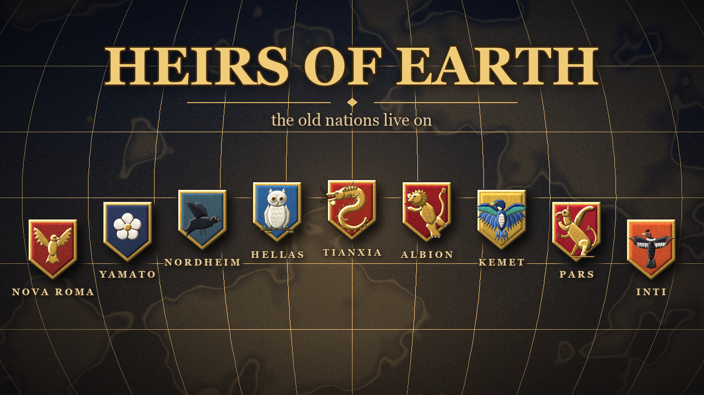

# Heirs of Earth

**A RimWorld 1.6 mod about nine nations that carry the heritage of Earth, and the colony caught between them.**

[](https://steamcommunity.com/sharedfiles/filedetails/?id=3845334110)
[](https://github.com/keremtrgl/heirsofearth/releases/latest)


[](#license)
[](https://steamcommunity.com/sharedfiles/filedetails/?id=3845334110)

</div>

---

Centuries ago, nine colony ships left Earth. Their descendants founded nine heir nations on the Rim, each one carrying the heritage of a real culture. They trade, study, marry, ally and go to war with each other, and with you. In the end, someone has to call them all to one table.

Start as the heir of one nation, or as an independent colony that learns the knowledge of the others through trade, study, alliances and war.

<div align="center">
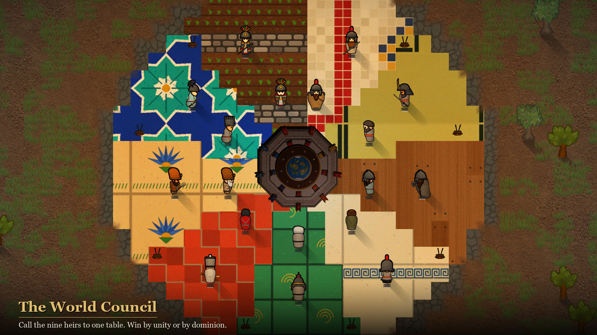
</div>

## The nine nations

| | Nation | Sign | Known for |
|:-:|---|---|---|
|  | **Nova Roma** | Eagle | Legions, roads, aqueducts and the Pax Romana |
|  | **Yamato Shogunate** | Sakura | Samurai, ashigaru, tea houses and bushido |
| 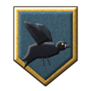 | **Jarldom of Nordheim** | Raven | Raiders, skalds, longhouses and the sagas |
|  | **League of Hellas** | Owl | Hoplites, philosophers, theatre and the phalanx |
|  | **Celestial Tianxia** | Dragon | Crossbows, fire lances, porcelain and the imperial examination |
|  | **Commonwealth of Albion** | Lion | Muskets, redcoats, steam engines and the factory |
| 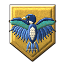 | **New Kemet** | Falcon | River farmers, scribes, obelisks and the composite bow |
| 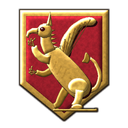 | **Satrapy of Pars** | Griffin | The royal road, paradise gardens, carpets and the Immortals |
| 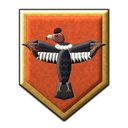 | **Inti Empire** | Condor | Mountain terraces, storehouses, slingers and the knotted quipu |

### What every nation brings

- **A research branch** with seven or more traditions that change how your colony works, some of them with a price, up to the industrial age.
- **Gear with hand-made art:** at least five weapons, five pieces of clothing and armour (leader regalia included, such as the Roman laurel wreath, the jarl's circlet or the Parsian kidaris), five buildings, three dishes, three floors and trade goods.
- **A defensive structure of its own:** the Roman scorpio, the Yamato yagura, the Tianxia fire-arrow battery, the Albion field cannon, the Inca sling stand and more.
- **Its own people:** soldiers, specialists, leaders and traders, with their own backstories, names and pack animals.
- **A start scenario** with five colonists, and its own settlement icon on the world map.
- **Two story chains:** the first ends with a lost relic, a hard choice and a legendary artifact; the second with a lost original to return or keep.

<table>
  <tr>
    <td width="50%">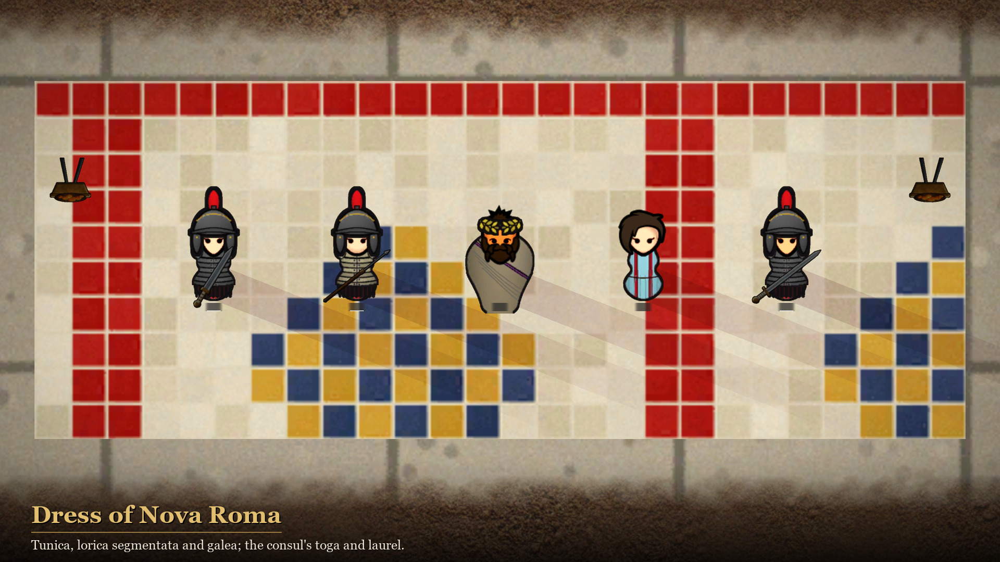</td>
    <td width="50%">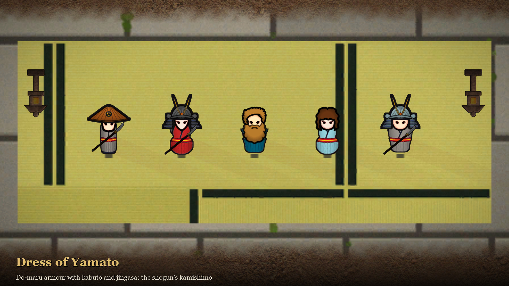</td>
  </tr>
  <tr>
    <td>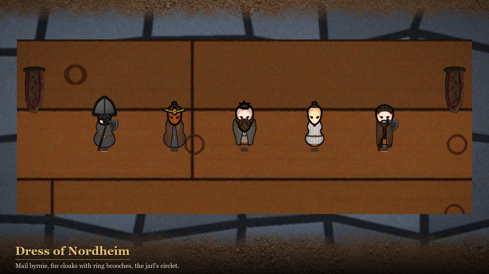</td>
    <td>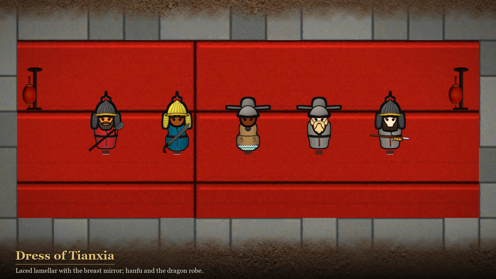</td>
  </tr>
  <tr>
    <td>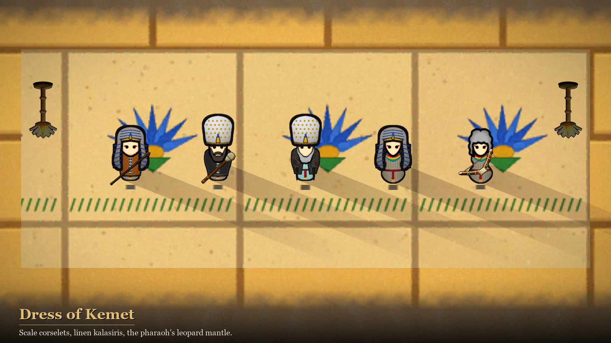</td>
    <td>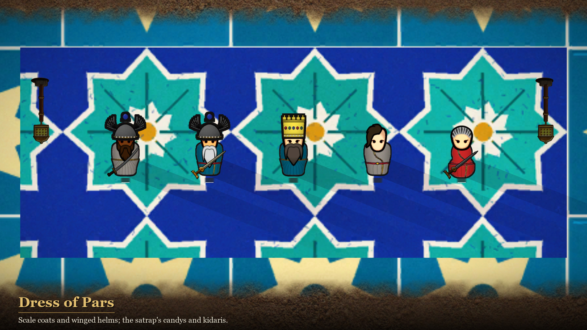</td>
  </tr>
</table>

## Features

<details open>
<summary><b>Ages of Progress</b></summary>

The nations do not stand still. Each one moves from the **Age of Founding** through the **Age of Powder** and the **Age of Steam** to the **Electric Age** at its own pace. Peace, allies, a scholarly ruler, many towns and treaties or trade with you speed it up; war, famine and plague hold it back. Each age brings the nation's own firearms, each with its own strength (the Roman arquebus, the Nordic hook gun, the Tianxia bird gun, the Albion breech-loader, the Persian rifle inlaid in khatam and more), its uniform coat in the Age of Steam, and its steel helmet and field uniform in the Electric Age. In the Electric Age every nation also has one powered building of its own (an electric forge, a telegraph office, an irrigation pump, a cold store and more), and the first nation to get there holds a **World Fair** where your best piece can win the grand prize. The Heirs tab shows where every nation stands and why.
</details>

<details open>
<summary><b>Living politics and courts</b></summary>

The nations run their own politics in the background: they form alliances, declare wars, capture each other's towns, send envoys, ask for tribute, offer marriages, ask you to mediate, and can collapse. Every nation has a ruler with a temperament; crowns pass and policies change. Sign treaties of peace, trade, science and defence, build an embassy, earn each nation's highest honour, and live through the Games, great fairs, famines and plagues.
</details>

<details>
<summary><b>Art of war</b></summary>

Every nation raids in its own way, each with its own drill: the Roman testudo, the Greek phalanx, Nordic shore raids, Yamato bushido, Tianxia's patient volleys, Albion's siege train, the Kemet chariot vanguard, Pars cavalry wings and Inti sappers. Every heir can also build a manned counterweight trebuchet.
</details>

<details>
<summary><b>Trade routes</b></summary>

Pay once to open a road to a friendly nation, and every 15 days a road caravan brings its goods and silver. Roads build relations and teach you the nation's culture, but caravans of nations at war may be raided, and a road closes when its nation turns on you.
</details>

<details>
<summary><b>Sagas, books and errands</b></summary>

Eighteen classic books and nine great books teach culture knowledge as your colonists read, and friendly nations send small errands by letter.
</details>

<details>
<summary><b>Sound and look</b></summary>

Every nation has its own music and a signature call, made for this mod. Heir weapons have their own firing sounds, and every heir garment has its own worn art on all five body types: hats, helmets, crowns and wreaths, and every tunic, robe, cloak and suit of armour, from the Roman lorica and the samurai's do-maru to the Inca feather cape.
</details>

<details>
<summary><b>The World Council</b></summary>

Finish three nation stories, or keep three trade roads open for a year, and the nations begin to speak of a council. Build the council hall and call them to the table. Win by **unity**, when two thirds of the living nations vote for it, or by **dominion**, when every nation still standing has sworn fealty to you. The game goes on after your victory.
</details>

<details>
<summary><b>Research browser, encyclopedia and settings</b></summary>

- The **Heirs tab** lists every heir research project in one place, filtered by nation, age and state, and tells you why a locked project is locked.
- The **encyclopedia** has a page for each nation: its story, ruler, relations, traditions and everything it makes.
- **Relaxed, Standard and Hard** presets set knowledge gain, research cost, raid strength, tribute and event frequency at once.
- Politics, the ages, trade routes, the World Council, war doctrines, world events, the music and every single nation can each be turned off.
- A **fourth speed button** (the game's own fastest speed, normally hidden) on key 4, which can also be turned off.
</details>

<table>
  <tr>
    <td width="33%">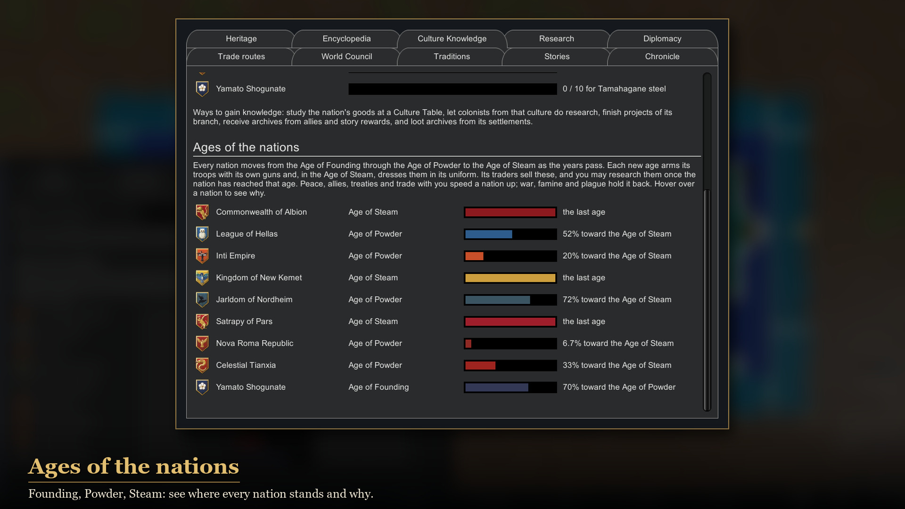</td>
    <td width="33%">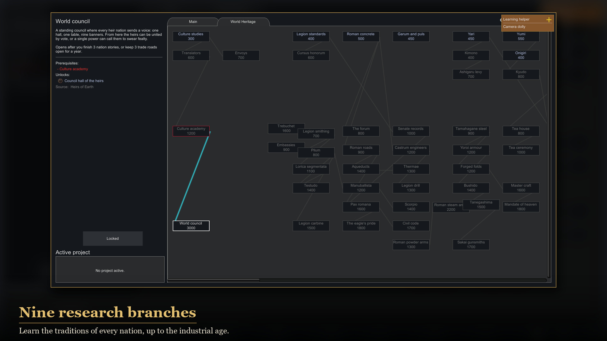</td>
    <td width="33%">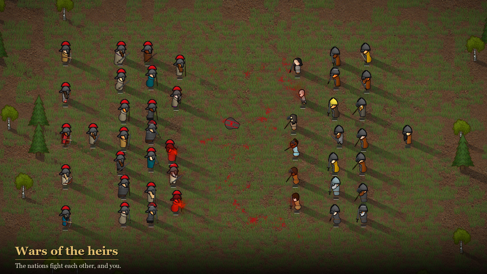</td>
  </tr>
</table>

## Installation

**Steam (recommended):** subscribe on the [Steam Workshop page](https://steamcommunity.com/sharedfiles/filedetails/?id=3845334110). Steam installs [Harmony](https://steamcommunity.com/sharedfiles/filedetails/?id=2009463077) for you.

**Manual:**

1. Install [Harmony](https://steamcommunity.com/sharedfiles/filedetails/?id=2009463077).
2. Download `HeirsOfEarth-<version>.zip` from the [latest release](https://github.com/keremtrgl/heirsofearth/releases/latest).
3. Unzip it into your `RimWorld/Mods` folder, so that you have `RimWorld/Mods/HeirsOfEarth/About/About.xml`.
4. Enable **Harmony** and then **Heirs of Earth** in the mod list.

### Compatibility

- RimWorld **1.6**. Core only, no DLC needed. With Royalty, the heir crowns count as noble headwear.
- **Safe to add to an existing save:** nations that are missing arrive with their own settlements.
- English, Turkish and Simplified Chinese (the Chinese is AI-assisted; corrections are welcome). A translation template for other languages is in [`HeirsOfEarth/TranslationTemplate`](HeirsOfEarth/TranslationTemplate); see `HOW_TO_TRANSLATE.txt` there.

## Repository layout

```
HeirsOfEarth/          The mod itself, exactly as it ships on Steam
  About/               Metadata, icon and preview
  Defs/  Patches/      Generated XML content (do not edit by hand, see below)
  Languages/           English, Turkish and Simplified Chinese
  Source/              C# source of HeirsOfEarth.dll (Harmony patches, politics, ages, UI)
  1.6/Assemblies/      The compiled HeirsOfEarth.dll
  Textures/  Sounds/   Art, music and sound effects made for the mod
tools/                 Python generators, art scripts, build and test scripts
  heirs_test/          The in-game test suite (probes) and the Steam uploader
docs/                  Design documents, balance notes and art sheets
workshop/Heirs_Steam/  Steam page texts, change notes and screenshots
CHANGELOG.md           Every release, newest first
```

## Building from source

The XML content is generated from Python, so changes go into `tools/` and not into `HeirsOfEarth/Defs`.

**Requirements:** Windows, RimWorld 1.6 with Harmony from the Steam Workshop, Python 3 with `pillow`, `numpy` and `scipy`, and the .NET SDK. The scripts expect the default Steam folders; change the paths at the top of the `.ps1` files if yours differ.

```powershell
cd tools
python -I heirs_build.py                              # generate Defs, patches and language files
python -I heirs_check.py                              # balance check
powershell -NoProfile -File heirs_compile.ps1         # compile HeirsOfEarth.dll
powershell -NoProfile -File heirs_test\run.ps1        # full in-game test run
```

`run.ps1` copies the mod into the game, starts one test instance of RimWorld with a throwaway save folder, runs more than 3,000 in-game checks (content, balance, politics, ages, raids, saving and loading) and closes the game. The summary is written to `%LOCALAPPDATA%\HeirsProbe\probe.log`. Use `-CompileOnly` to only build the test assembly.

> The worn body-armour art (`tools/heirs_art19.py`) is fitted to the game's own body shapes. Those reference masks come from the game's textures, so they are not part of this repository; the finished art is.

## Version history

The current version is **4.3.1**. See [CHANGELOG.md](CHANGELOG.md) for every release, from the first three nations to the Electric Age. Next on the roadmap: nation cities, quests on the world map, and Combat Extended and more languages.

## Feedback

Bug reports and ideas are welcome on the [Steam Workshop page](https://steamcommunity.com/sharedfiles/filedetails/?id=3845334110) or in the [issues](https://github.com/keremtrgl/heirsofearth/issues). For a bug, please add your mod list and a log ([HugsLib](https://steamcommunity.com/sharedfiles/filedetails/?id=818773962) or the `Player.log` file helps a lot).

## License

Heirs of Earth uses two licenses, so that modders can learn from and reuse the code while the art and writing stay credited and non-commercial.

| What | License | File |
|---|---|---|
| **Code**: the C# source, the Python, PowerShell and test scripts, and the XML structure | [MIT](https://opensource.org/license/mit) | [LICENSE](LICENSE) |
| **Creative assets**: textures, music and sounds, names, descriptions, stories and other in-game text, Steam texts and screenshots | [CC BY-NC-SA 4.0](https://creativecommons.org/licenses/by-nc-sa/4.0/) | [LICENSE-ASSETS](LICENSE-ASSETS) |

In short: use the code freely, credit "Heirs of Earth by Kerem" when you use the art or text, don't sell them, and share your changes under the same terms. Translations and compatibility patches are welcome. Please don't re-upload the whole mod to the Steam Workshop; link to the original instead.

## Credits

Made by **Kerem**. Built with [Harmony](https://github.com/pardeike/Harmony) by Andreas Pardeike. RimWorld is a game by Ludeon Studios; this is a fan-made mod and is not affiliated with Ludeon Studios.
